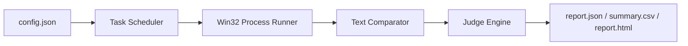

# mini-judge-core

`mini-judge-core` is a Windows-only batch judging engine demo.  
It is meant to showcase execution control, scheduling, judging, and reporting, not to act as a production online judge.

## What It Is

- A local CLI for evaluating existing `.exe` programs against static test files
- A compact rewrite inspired by earlier `hw_check_exe` and `txt_compare` experience
- A showcase repository for engineering implementation choices

## What It Is Not

- Not a web OJ
- Not a sandboxed execution platform
- Not a database-backed grading system
- Not a multi-language compiler service

## Demo Pipeline



## Showcase Highlights

- Win32 subprocess control with explicit handle inheritance, Job Object process-tree cleanup, and wall-clock timeouts
- File-backed finite stdin, separate stdout/stderr pipes, and a combined output budget
- Fixed-size worker pool with a bounded FIFO queue, producer backpressure, and task exception handling
- Small compare-mode set focused on deterministic demo behavior
- Three report surfaces:
  - `report.json`
  - `summary.csv`
  - `report.html`
- Sample integration case with `AC`, `WA`, and `TLE` outcomes
- Fault fixtures and report-content checks that also run in Release builds

The execution, configuration, cancellation, and failure semantics are documented
in [the reliability contract](docs/reliability.md). Each execution now runs in its
own temporary working directory. Programs must use stdin/stdout or explicit paths
for external files. The output limit counts stdout and stderr together; only
stdout participates in answer comparison.

## Relationship To Earlier Work

This project is not a direct copy of the older codebase.

- From `hw_check_exe`, it keeps the batch-grading workflow and worker-queue mentality
- From `test_exe_running`, it keeps the Win32 process-control lessons
- From `txt_compare`, it keeps the idea that comparison rules should be explicit

The point of this repository is to present those ideas in a smaller and cleaner structure.

## MVP Scope

- Windows only
- Existing `.exe` inputs only
- Static `.out` answer files only
- JSON config input
- Optional split between `test_dir` and `answer_dir`
- JSON, CSV, and HTML report output

## Build

Use CMake 3.20+, a C++17 Windows compiler, and PowerShell 7 (`pwsh`) for the
end-to-end test suite. Tests check verdicts and generated reports as well as
process exit codes. Runtime checks stay enabled in Release builds.

### Visual Studio / MSVC

```powershell
cmake -S . -B build
cmake --build build --config Debug
ctest --test-dir build -C Debug --output-on-failure
```

### MinGW

Put Ninja and the MinGW compiler/runtime directory on `PATH`. Ninja is used here
because the bundled MinGW Make tool failed to resolve source files under a
Chinese path during validation; the same source path built successfully with
Ninja. Adjust the compiler path for your installation.

```powershell
$env:Path = "C:\Program Files (x86)\Dev-Cpp\MinGW64\bin;$env:Path"
cmake -G Ninja `
  -DCMAKE_CXX_COMPILER="C:/Program Files (x86)/Dev-Cpp/MinGW64/bin/g++.exe" `
  -DCMAKE_BUILD_TYPE=Release `
  -S . -B build-mingw
cmake --build build-mingw
ctest --test-dir build-mingw --output-on-failure
```

## Run The Demo

After building, run:

```powershell
build\Debug\mini_judge.exe --config build\sample_runtime\Debug\configs\demo_problem.json --jobs 2
```

Or for MinGW:

```powershell
build-mingw\mini_judge.exe --config build-mingw\sample_runtime\Release\configs\demo_problem.json --jobs 2
```

The demo produces:

- `report.json`
- `summary.csv`
- `report.html`

## Real Dataset Adapter

If you want to run the engine against the legacy `25261-term` course dataset, use:

```powershell
pwsh -File .\tools\Export-25261TermConfig.ps1 `
  -ProgramDir "D:\25261-term\exec-vs-3-b3-2.cpp-by-win" `
  -InputDir "D:\25261-term\测试数据" `
  -AnswerDir "D:\25261-term\参考答案（测试中不用，仅用于调试时参考）\3-b3" `
  -OutputConfig ".\generated\25261-term-vs-3-b3-2.json" `
  -ReportDir ".\reports\25261-term-vs-3-b3-2"
```

Optional roster filtering is supported:

```powershell
pwsh -File .\tools\Export-25261TermConfig.ps1 `
  -ProgramDir "D:\25261-term\exec-vs-3-b3-2.cpp-by-win" `
  -InputDir "D:\25261-term\测试数据" `
  -AnswerDir "D:\25261-term\参考答案（测试中不用，仅用于调试时参考）\3-b3" `
  -RosterPath "D:\25261-term\25261-stulist-part.txt" `
  -OutputConfig ".\generated\25261-term-part.json" `
  -ReportDir ".\reports\25261-term-part"
```

Then run:

```powershell
.\build-mingw\mini_judge.exe --config .\generated\25261-term-part.json --jobs 8 --quiet-progress
```

## Real Dataset Result

The original version was exercised against the legacy `25261-term` Visual Studio
dataset on 2026-05-12. These are historical results, not a rerun of the reliability
fixes:

- Programs: `744`
- Testcases per program: `32`
- Total cases: `23808`
- Overall status counts:
  - `AC = 6088`
  - `WA = 17720`
  - `TLE = 0`
  - `RE = 0`
  - `OLE = 0`
  - `SE = 0`
- Program-level distribution:
  - `167` programs achieved full `32/32`
  - `545` programs achieved `0/32`
  - `32` programs partially passed
  - Average score: `8.18 / 32`

That run produced:

- `reports/25261-term-full/report.json`
- `reports/25261-term-full/summary.csv`
- `reports/25261-term-full/report.html`

The dataset and generated reports are local historical artifacts, not bundled
with this repository. For a reproducible checkout, use the built-in demo and
fault fixtures. The Windows CI artifacts contain test results and demo reports.

## Repository Notes

- Design notes live in [docs/design-notes.md](docs/design-notes.md)
- Legacy dataset notes live in [docs/25261-term-showcase.md](docs/25261-term-showcase.md)
- Repository layout notes live in [docs/repo-layout.md](docs/repo-layout.md)
- Execution and validation semantics live in [docs/reliability.md](docs/reliability.md)
- P0/P1 fixes and local verification are recorded in [docs/p0-p1-validation.md](docs/p0-p1-validation.md)
- CI workflow lives in [.github/workflows/windows.yml](.github/workflows/windows.yml)

## Limitations

- No sandbox guarantees
- No source compilation pipeline
- No memory-limit enforcement
- No checker/SPJ integration
- No claim of production robustness

Those limitations are intentional. The repository is designed to be small, inspectable, and easy to explain in a portfolio or interview setting.
